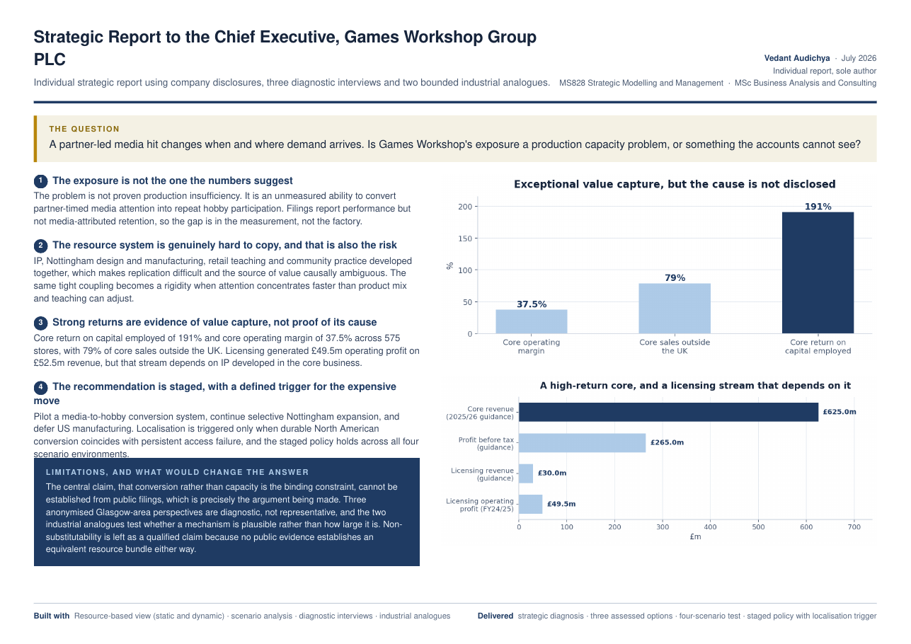

# Games Workshop Group PLC: Strategic Report to the Chief Executive

> A partner-led media hit changes when and where demand arrives. Is Games Workshop's exposure a production capacity problem, or something the accounts cannot see?

| | |
|---|---|
| **Role** | **Individual report, sole author** |
| **Context** | MS828 Strategic Modelling and Management · MSc Business Analysis and Consulting, University of Strathclyde · Jul 2026 |
| **Evidence base** | Company disclosures, three anonymised diagnostic interviews and two bounded industrial analogues |
| **Methods** | Resource-based view (static and dynamic) · scenario analysis · diagnostic interviews · industrial analogues |

## Key findings

1. **The exposure is not the one the numbers suggest.** The problem is not proven production insufficiency. It is an unmeasured ability to convert partner-timed media attention into repeat hobby participation. Filings report performance but not media-attributed retention, so **the gap is in the measurement, not the factory**.
2. **The resource system is hard to copy, and that is also the risk.** IP, Nottingham design and manufacturing, retail teaching and community practice developed together, which makes replication difficult. The same tight coupling becomes a rigidity when attention concentrates faster than product mix and teaching can adjust.
3. **Strong returns are evidence of value capture, not proof of its cause.** Core return on capital employed of **191%** and core operating margin of **37.5%** across **575 stores**, with **79%** of core sales outside the UK. Licensing generated **£49.5m** operating profit on **£52.5m** revenue, but that stream depends on IP developed in the core business.
4. **The recommendation is staged, with a defined trigger for the expensive move.** Pilot a media-to-hobby conversion system, continue selective Nottingham expansion, and defer US manufacturing. Localisation is triggered only when durable North American conversion coincides with persistent access failure. The staged policy holds across all four scenarios.

## Deliverables

Strategic diagnosis · three assessed options · four-scenario test · staged policy with a localisation trigger

## Limitations

- The central claim, that conversion rather than capacity is the binding constraint, cannot be established from public filings, which is precisely the argument being made.
- Three anonymised Glasgow-area perspectives are diagnostic, not representative.
- The two industrial analogues test whether a mechanism is plausible, not how large it is.

## Files

- [`one-pager.pdf`](one-pager.pdf) — one-page project summary

---
**Vedant Audichya** · MSc Business Analysis and Consulting, University of Strathclyde · [LinkedIn](https://www.linkedin.com/in/vedantaudichya) · [All projects](https://github.com/Vedant-Au)
